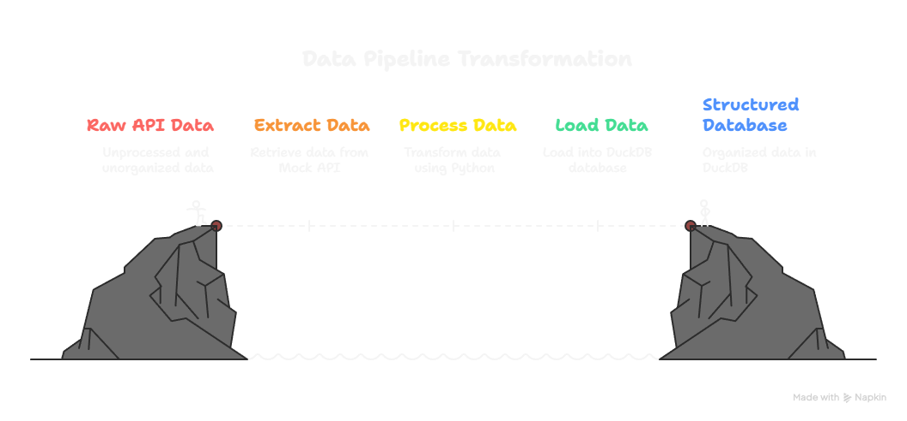

# 🛠️ Data Engineering Pipeline: API to DuckDB with Airflow

This repository contains a simple and modular data engineering project that demonstrates how to:
- Extract data from an API
- Transform and validate it
- Load it into a local **DuckDB** database
- Orchestrate the entire process with **Apache Airflow**

It's ideal for beginners or junior data engineers looking to practice core ETL skills using modern tools.

---

## 📷 Architecture du Projet

<!-- Image représentant l'architecture globale du pipeline -->


---


## 📁 Project Structure

```bash
DE-Fold/
├── airflow/                   # Airflow DAGs and configs
├── degpt-env/                 # Python virtual environment (do not track in GitHub)
├── logs/dag_processor/        # Airflow logs
├── docker-compose.yaml        # Docker config to spin up Airflow
├── Dockerfile                 # Dockerfile (optional: customize image)
├── requirements.txt           # Python libraries required
├── init/db/                   # Folder for DB init scripts
├── init-db.py                 # Script to initialize DuckDB schema/tables
├── ecommerce_data.duckdb      # DuckDB file with sample data
├── etl_creation.log           # Log file tracking ETL runs
└── testing-function.py
└── README.md       